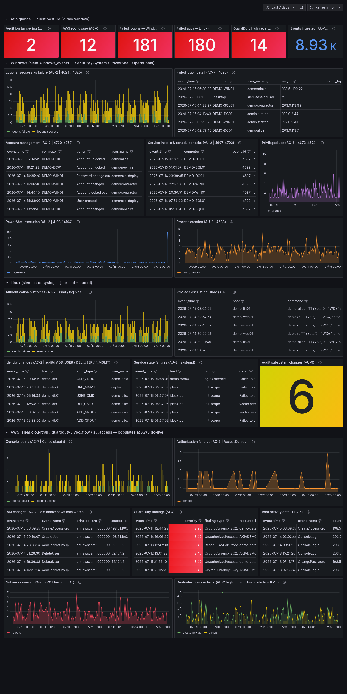

# ironlog — self-hosted SIEM

A NIST 800-53-oriented SIEM built from self-hosted components:
**ClickHouse** for storage, SQL and full-text search, **Vector** for all
collection, and **Grafana OSS** as the single UI for log search, dashboards
and alerting, with native local accounts. Keycloak integration is deferred; ironlog does
not deploy an identity provider. No ingest caps, no license keys, no
phone-home, no per-seat pricing.

The project exists because commercial/openish alternatives gate the
compliance-critical features (SSO, RBAC, audit trails, >50 GB/day) behind paid
tiers. Here, the audit evidence *is* the product: every design choice traces
to an AU-family control in [docs/control-mapping.md](docs/control-mapping.md).

## Dashboard



The weekly ISSO review dashboard (shown populated with synthetic demo data):
at-a-glance control tripwires across the top — audit-log tampering (AU-9), root
usage (AC-6), failed logons (AC-7), high-severity GuardDuty (SI-4) — then
Windows, Linux, and AWS sections covering every AU-2-committed event family,
each panel tagged with its control ID. Querying: [docs/query-guide.md](docs/query-guide.md).

## Architecture



[Architecture details](docs/architecture.md) ·
[Concept view](docs/images/ironlog-concepts/ironlog-concepts.svg) ·
[Editable diagram](docs/images/ironlog-architecture/ironlog-architecture.drawio) ·
[PNG](docs/images/ironlog-architecture/ironlog-architecture.png) ·
[Ingestion paths](docs/images/ironlog-ingestion/ironlog-ingestion.svg) ·
[User access and audit flow](docs/images/ironlog-access-audit/ironlog-access-audit.svg)

Grafana authenticates its own local users. Finished queries and processing
errors are captured in `audit.query_archive` under shared database service
accounts, not individual app identities. Ingest happens through the write-only
`svc_vector` account; analysts can never write, auditors can also read the
analyst-activity trail.

## Images

Ironlog ships as three container images, built from `images/` and published
for `linux/amd64` and `linux/arm64` to GitHub Container Registry. All
configuration is baked in; a deployment supplies only environment variables,
one data volume per container, networking and secrets. They run as non-root
and also under an arbitrary UID with GID 0 (OpenShift `restricted-v2`).
Contract: [images/README.md](images/README.md).

| Image | Upstream (pinned) | License | Role |
|---|---|---|---|
| `ghcr.io/jake-kelley/ironlog-clickhouse:26.8.34.13` | clickhouse/clickhouse-server:26.8.34.13 (LTS) | Apache-2.0 | storage, SQL, full-text (text index), RBAC, audit trail; optional S3 cold tier; also runs the one-shot `ironlog-schema` |
| `ghcr.io/jake-kelley/ironlog-grafana:13.3.0` | grafana/grafana:13.3.0 + ClickHouse plugin 4.23.4 | AGPL-3.0 | only UI: log search, dashboards, AU-5 alerting, local accounts |
| `ghcr.io/jake-kelley/ironlog-vector:0.61.0` | timberio/vector:0.61.0-debian | MPL-2.0 | `IRONLOG_VECTOR_ROLE=hosts`: agents (:6000) and Kubernetes HEC (:8088); `aws`: CloudTrail, GuardDuty, VPC Flow, S3 access via SQS |

Each image is also tagged `<version>-<git sha>`. Pushes to `main` publish
them with an SBOM attestation and a Grype report
([images workflow](.github/workflows/images.yml)). The local k3s demo
(`rancher/k3s:v1.37.1-k3s1`, Compose profile `k3s`) is a test producer, not
part of the SIEM.

Remaining component licenses (Apache-2.0, AGPL-3.0, MPL-2.0) are
OSI-approved. The BOM lists constituent software, not Ironlog as a separate
product. Artifact license coverage remains incomplete; FOCI assurance is not
established. See [FOSS/FOCI assessment](docs/foss-foci-assessment.md),
[BOM](docs/bom.md), [CycloneDX SBOM bundle](sbom/README.md) and the
[vulnerability report](https://jake-kelley.github.io/ironlog/).

## Deployment targets

The same images run everywhere, on one host or split across several.

| Target | Status | Guide |
|---|---|---|
| Podman + systemd Quadlets on Oracle Linux 9 | verified live: single host, split host (ClickHouse alone), S3 cold tier, reboots | [quadlets/README.md](quadlets/README.md) |
| Compose (Podman or Docker) | development stack, builds the images locally | [Fresh install](#fresh-install) |
| Kubernetes / OpenShift (Helm) | CI install on kind under the restricted Pod Security profile; no live OpenShift run yet | [deploy/helm/ironlog/README.md](deploy/helm/ironlog/README.md) |
| Amazon ECS on EC2 | planned (wave 2) | — |
| EC2 AMI appliance (Packer, RHEL 9 / Rocky 9) | legacy; superseded by the images, retirement pending | [packer/README.md](packer/README.md) |

## Repository layout

    images/                      Dockerfiles, entrypoints, portability contract
    quadlets/                    podman systemd units for the images; host/ firewall unit
    deploy/helm/ironlog/         Helm chart (Kubernetes, EKS, OpenShift)
    docker-compose.yml           development stack (builds images/ locally)
    bootstrap.sh                 fresh Compose install
    .env.example                 every secret/setting, annotated
    clickhouse/
      ddl/                       schemas, audit trail, RBAC, search view
      config.d/ users.d/         listen config, query_log, default-user lockdown
    vector/
      vector.yaml                AWS pipelines (CloudTrail/GuardDuty/VPCFlow/S3)
      hosts.yaml                 host+K8s aggregator (HEC :8088, native :6000)
      agent-linux.yaml           drop-in config for Linux hosts
      agent-windows.yaml         drop-in config for Windows hosts
      tests.yaml tests-hosts.yaml  VRL unit tests
    grafana/provisioning/        datasources, dashboards, AU-5 alert rules
    k8s/                         vector-shipper DaemonSet; k3s demo
    scripts/
      tests/                     image tests, OL9 Quadlet end-to-end test
      install-windows-agent.ps1  elevated Windows agent installer
      generate-sbom.py, scan-image-sboms.py, build-vuln-report.py   SBOM and report
      okf-validate.py            OKF conformance checker for docs/
    .github/workflows/           images, helm (kind), sbom (Grype, Pages)
    docs/                        OKF v0.1 knowledge bundle (runbooks, policies, catalog)
    sbom/                        declared inventory, CycloneDX bundle, image SBOMs
    keycloak/realm-export/       historical realm reference; not deployed

    --- legacy EC2 AMI appliance ---
    packer/  scripts/ami/  scripts/firstboot/  scripts/build-ami.sh  scripts/prepare-artifacts.py

## UIs

| URL | What | Auth |
|---|---|---|
| http://localhost:3000 | Grafana — log search, dashboards, SQL (Explore), alerts | Compose: local `admin` / `IronlogDev123!` |

The Compose credentials are generic development values for fresh installs;
existing accounts are preserved. Quadlet hosts set the Grafana admin password
in their environment file; the Helm chart generates one and keeps it across
upgrades. See [local authentication](docs/local-auth.md). ClickHouse
(`:8123`/`:9000`) is bound to loopback by default; split-host mode exposes it
only to the hosts listed in `IRONLOG_CLICKHOUSE_ALLOWED_HOSTS`.

Dashboards (Grafana -> SIEM folder):
- **Log Search**: free-text search across Linux, Windows, Kubernetes,
  CloudTrail and GuardDuty events via the `siem.log_search` view, using ClickHouse text indexes
  (`hasAllTokens` / `hasAnyTokens`), with source/host/user filters, log
  volume, and a logs panel with context. Linked from AWS Security Overview.
- **800-53 Logging Evidence — Weekly ISSO Review**: the weekly audit pass —
  at-a-glance posture stats (tampering, root usage, failed auth, GuardDuty),
  then Windows / Linux / AWS sections with every AU-2-committed event family,
  control IDs in each panel title.
- **AWS Security Overview**: console logins, AccessDenied trend, root
  activity, IAM writes.
- **Pipeline Health (AU-5)**: per-source ingest lag + rate.

New to querying? Start with [docs/query-guide.md](docs/query-guide.md).

## Fresh install

Run these commands from the repository root in a Bash shell.

1. Prereqs: Podman with a working Compose provider, Bash, and OpenSSL.
   Docker Engine with Compose v2 is also supported.
2. `./bootstrap.sh` — generates `.env` with generic app logins and random
   backend credentials, starts the stack (building the images on first run),
   and verifies RBAC.
3. Open http://localhost:3000 and log in as `admin` / `IronlogDev123!`.
4. Onboard data sources (next section).

Podman is the default. For Docker, run
`IRONLOG_CONTAINER_RUNTIME=docker ./bootstrap.sh`. Bootstrap records the
selection in `.env`; `scripts/compose.sh up -d`, `scripts/compose.sh logs`,
and `scripts/compose.sh down` use it for later operations. Switching engines
does not migrate existing containers or volumes.

`podman compose` requires an external provider such as `podman-compose` or
Docker Compose. Select one with `PODMAN_COMPOSE_PROVIDER` if needed; see
[Podman's Compose documentation](https://docs.podman.io/en/latest/markdown/podman-compose.1.html).
On Windows/macOS, start a Podman machine before bootstrap.

`bootstrap.sh` refuses to overwrite an existing `.env`. Fully wipe with
`scripts/compose.sh down -v` (destroys data).

For a server install, use the published images instead: Quadlets on Oracle
Linux 9 ([quadlets/README.md](quadlets/README.md)) or the Helm chart:

```bash
kubectl create namespace ironlog
helm install ironlog deploy/helm/ironlog -n ironlog
```

## Data source onboarding

| Source | Status here | Runbook |
|---|---|---|
| Linux hosts (journald+auditd) | agent and normalization implemented | [docs/host-ingestion.md](docs/host-ingestion.md) |
| Kubernetes (any cluster, HEC) | shipper and HEC ingestion implemented | same |
| Windows (Security/System/PowerShell) | agent and normalization implemented | same |
| AWS CloudTrail/GuardDuty/VPCFlow/S3 | staged — needs account wiring | [docs/aws-ingestion.md](docs/aws-ingestion.md) |

AWS go-live: follow the runbook (S3 -> SQS -> least-privilege IAM), fill the
Phase 2 block in `.env`, uncomment `COMPOSE_PROFILES=aws`, `scripts/compose.sh up
-d`, then un-pause the four AWS alert rules (Alerting -> AU-5 pipeline health).

## Security model

- **Authentication**: Grafana uses native local accounts.
  Anonymous access is not enabled. No SSO or mandatory MFA is provided in
  this mode. Future OIDC integration will use an existing external Keycloak;
  ironlog will not deploy Keycloak or its Postgres database.
- **Authorization** (ClickHouse enforces, not the UIs):

  | Account | Can | Cannot |
  |---|---|---|
  | svc_vector | INSERT siem.* | read anything |
  | svc_grafana_analyst | SELECT siem.* | write; read audit.* |
  | svc_grafana_auditor | SELECT siem.* + audit.* | write |
  | siem_admin (bootstrap) | everything | — |

  App roles are managed locally. Shared Grafana datasources do not enforce
  per-human analyst/auditor separation. Readers run under a settings profile: SELECT-only,
  8 GB / 120 s / 20B-rows per query.
- **Audit trail (AU-9)**: an incremental MV copies every finished query from
  system.query_log into append-only `audit.query_archive` (2-year TTL) —
  including every query Grafana runs on anyone's behalf.
- **Network**: ClickHouse/native+HTTP bound to localhost on the host; the
  in-container `default` user is loopback-confined; ingest listeners (:6000,
  :8088) are token/marker-validated at the aggregator and write-only at the DB.
- **Secrets**: `.env` is git-ignored and mode 600. Bootstrap generates backend
  passwords; app credentials default to the documented development values.

## Compliance surface

The `docs/` directory is an [Open Knowledge Format](https://github.com/GoogleCloudPlatform/knowledge-catalog/blob/main/okf/SPEC.md)
(OKF v0.1) knowledge bundle — every doc carries YAML frontmatter (`type`,
`title`, `description`, `tags`), `docs/index.md` lists the bundle, and
`docs/log.md` tracks changes. Conformance is enforced by
`python3 scripts/okf-validate.py docs` (start at [docs/index.md](docs/index.md)).

- [docs/control-mapping.md](docs/control-mapping.md) — control -> artifact map (auditor-facing)
- [docs/event-catalog.md](docs/event-catalog.md) — the AU-2 commitment; VRL implements exactly this
- [docs/retention-policy.md](docs/retention-policy.md) — AU-11 numbers (DRAFT: total-retention needs confirmation)
- [docs/query-guide.md](docs/query-guide.md) — analyst quick-start for Grafana search and SQL
- AU-5: provisioned alert rules fire on source silence (per-table thresholds),
  and on ClickHouse being unreachable (NoData/Error -> alerting). Notifications
  route to the `siem-oncall` contact point — set a real address + SMTP.

## Operations

- **Start/stop**: `scripts/compose.sh up -d --build` builds the ironlog images
  from `images/` on first use (no config bind mounts); `scripts/compose.sh down`
  (add `--profile aws --profile k3s` to include optional services). On
  Quadlet hosts, use systemd; see [Quadlet operations](quadlets/README.md).
- **Weekly ISSO pass**: open the 800-53 dashboard, review each section (red
  stats first), check Alerting for anything firing, spot-check
  `audit.query_archive` via the audit-trail datasource.
- **VRL changes**: edit vector/*.yaml, run the unit tests, restart the service:

      podman run --rm -v "$PWD/vector:/cfg:ro,z" -e AWS_REGION=x \
        -e SQS_URL_CLOUDTRAIL=x -e SQS_URL_GUARDDUTY=x -e SQS_URL_VPCFLOW=x \
        -e SQS_URL_S3ACCESS=x -e CH_VECTOR_PASSWORD=x \
        docker.io/timberio/vector:0.61.0-debian test /cfg/vector.yaml /cfg/tests.yaml
      podman run --rm -v "$PWD/vector:/cfg:ro,z" -e SPLUNK_HEC_TOKEN=x \
        -e CH_VECTOR_PASSWORD=x \
        docker.io/timberio/vector:0.61.0-debian test /cfg/hosts.yaml /cfg/tests-hosts.yaml

- **Account recovery**: local app accounts persist in Grafana data.
  Changing initial-account environment values does not reset existing users.
  See [local authentication](docs/local-auth.md).
- **Version bumps**: images are pinned; bump deliberately, one at a time, and
  re-run the vector unit tests + a bootstrap on a scratch host before fleet
  changes.
- **Windows idle-freeze pilot** (vector#25194): the AU-5 Windows rule is the
  tripwire. If it fires while the host is active and the service is Running:
  `Restart-Service vector` (agent disk buffers prevent loss).

## Field notes / troubleshooting

Hard-won lessons encoded in this repo — check here before debugging:

- **ClickHouse in docker listens on loopback only** by default; other
  containers can't reach it. `config.d/05-listen.xml` sets 0.0.0.0 (`::`
  crashes on IPv6-less compose networks, exit 210).
- **Never mount users.d read-only over the whole directory** — the image
  entrypoint must write default-user.xml there (crash loop otherwise). Mount
  individual files.
- **Vector >= 0.57 does not interpolate `${VAR}` in configs by default.**
  Set `VECTOR_DANGEROUSLY_ALLOW_ENV_VAR_INTERPOLATION=true` (compose sets it;
  agents need it too). Interpolation is pre-parse text substitution, so a
  dollar-brace reference **even inside a comment** aborts config load.
- **Vector's clickhouse sink healthcheck probes without auth** and 403s
  against the locked-down default user — sink healthchecks are disabled in
  our configs; inserts are authenticated and unaffected.
- **Windows services can't use the WSL2 localhost relay** (interactive
  sessions only). Agents on the docker host must target the WSL NAT IP —
  `scripts/fix-windows-agent-addr.ps1 -Register` keeps it correct per boot.
- **PowerShell scripts must stay pure ASCII**: PowerShell 5.1 reads BOM-less
  UTF-8 as ANSI; an em-dash becomes a smart quote and kills parsing.
- **Pods inside in-docker k3s can't resolve docker DNS names** (k3s swaps
  loopback resolvers for a public one) — `k8s/k3s-demo-up.sh` patches the
  shipper endpoint to the aggregator IP.
- **Vector 0.61 agent sinks**: `compression: true` was removed in 0.59 (use
  `"gzip"`), and since 0.61 a scheme-less sink address defaults to https, so
  agents prefix `http://` to reach the plaintext aggregator on :6000.
- **ClickHouse's docker entrypoint runs `/docker-entrypoint-initdb.d` only when
  the data directory is empty.** A container that dies partway through init
  leaves a non-empty `metadata/` and the DDL is then skipped *forever* on every
  subsequent start — a healthy-looking server with no schema. `SELECT 1`
  healthchecks pass against an empty database, so nothing downstream notices;
  this is why `ironlog-schema` runs as a separate one-shot that gates Grafana
  and Vector.
- **The audit trail uses a standard incremental MV**, chosen on ClickHouse
  24.8 where `REFRESH ... APPEND` was experimental, and kept on 26.8.
  `system.query_log`
  doesn't exist until first flush — DDL runs `SYSTEM FLUSH LOGS` first.
- WSL idle-shutdown stops the stack between sessions; the boot task (or any
  open WSL shell) keeps it alive.

## CI and supply chain

- **[Images](.github/workflows/images.yml)**: builds the three images for
  amd64 and arm64 and runs `scripts/tests/*-image.test.sh` on pull requests;
  pushes to `main` publish to GHCR with an SBOM attestation and a Grype report.
- **[Helm](.github/workflows/helm.yml)**: `helm lint`, kubeconform, then an
  install on kind under the restricted Pod Security profile with Grafana,
  datasource, HEC ingest and upgrade checks.
- **[SBOM](.github/workflows/sbom.yml)**: regenerates the SBOM bundle, runs
  Grype weekly and publishes the [vulnerability report](https://jake-kelley.github.io/ironlog/)
  to GitHub Pages.
- `scripts/tests/ol9-quadlet-e2e.sh` repeats the Oracle Linux 9 Quadlet test
  on a live host.

## Roadmap

- **Portable containers, wave 1 (done 2026-11-04)**: three images on GHCR,
  Quadlets verified on Oracle Linux 9 (single host, split host, S3 cold tier),
  Helm chart tested on kind, CI for all of it.
- **Wave 2**: Amazon ECS on EC2, ClickHouse S3 tier on real AWS S3 with an
  instance role, a live OpenShift test, TLS between services, Grafana 13.3.1.
- **Retention and archive**: Object Lock raw archive (Parquet via aws_s3
  sink), query_archive export. Retention numbers pending confirmation in
  retention-policy.md. AU-5 alerting: done.
- **Detections**: detection SQL + alert rules per control family.
- **Operations**: review checklists, evidence exports, annual catalog review.

External Keycloak integration is deferred; the default is local app accounts.

## Known issues

- **Existing app databases** retain their credentials. Generic defaults do
  not reset accounts; see [local authentication](docs/local-auth.md).
- **TLS between services** is not implemented; terminate TLS in front of
  Grafana and keep ClickHouse on loopback or an allowlisted private network.
- **Legacy AMI build** leaks one 100 GiB volume per Packer build: the
  builder's `/dev/sdb` carries `delete_on_termination = false` in
  `packer/sources.pkr.hcl`.

## License

Ironlog is licensed under the [Apache License, Version 2.0](LICENSE). See
[NOTICE](NOTICE). The published images also contain ClickHouse, Vector and
Grafana under their own licenses (Apache-2.0, MPL-2.0 and AGPL-3.0-only);
[docs/bom.md](docs/bom.md) lists them.
