# Ironlog architecture



[Editable draw.io](images/ironlog-architecture/ironlog-architecture.drawio) ·
[PNG](images/ironlog-architecture/ironlog-architecture.png) ·
[SVG](images/ironlog-architecture/ironlog-architecture.svg) ·
[DOT source](images/ironlog-architecture/ironlog-architecture.dot)

Rebuilt on 2026-11-04 against the portable-container layout in
[images/README.md](../images/README.md). Seven bands read top to bottom:
five lanes (sources, ingestion, data, applications, people), then the three
ironlog images, then deployment targets, then the legend. Every box carries a
`Role:` caption, versions and ports where useful, and a NIST 800-53 tag only
where [control mapping](control-mapping.md) supports it. Purple means event
sources or people, teal ingestion, blue data stores and database accounts,
amber applications and jobs, slate images and deployment targets, grey
planned or legacy. Colors describe roles, not license findings or health.

Connections show logical relationships without arrowheads: labels give the
protocol, port or database action. They do not assert encrypted transport,
a running deployment, or high availability. AWS ingestion is optional and not
a dependency for on-prem host or Kubernetes logs.

The three images (`ironlog-clickhouse:26.8.34.13`, `ironlog-grafana:13.3.0`
with ClickHouse plugin 4.23.4, `ironlog-vector:0.61.0`) are built from
`images/` with configuration baked in; CI publishes them to
`ghcr.io/jake-kelley` on pushes to `main`. The Vector image runs as role
`hosts` (HEC 8088 plus native 6000) or role `aws` (SQS/S3). The one-shot
`ironlog-schema` runs from the ClickHouse image and gates Grafana and both
Vector roles. The ClickHouse S3 cold tier is optional: `IRONLOG_S3_TIER=on`
moves parts older than `IRONLOG_HOT_DAYS` to S3.

## Component roles

| Component | Role | Version / ports | Required? | Tags |
|---|---|---|---|---|
| Windows hosts (Vector agent) | Ship Security, System and PowerShell/Operational event logs to the aggregator | Native TCP 6000 | Per host | AU-12 |
| Linux hosts (Vector agent) | Ship journald and auditd (`/var/log/audit/audit.log`) events | Native TCP 6000 | Per host | AU-12 |
| Kubernetes `vector-shipper` | DaemonSet ships pod logs over token-authenticated HEC; local k3s is a demo producer | `timberio/vector:0.61.0-distroless-libc`, HEC 8088 | Per cluster | AU-12 |
| AWS logs | CloudTrail, GuardDuty, VPC Flow and S3 access logs in S3; one SQS queue per type | S3 + SQS | Optional | AU-12 |
| Vector role `hosts` | Always-on aggregator: routes by source, VRL normalisation, disk buffer, INSERT to ClickHouse | `ironlog-vector:0.61.0`, 6000, 8088 | Yes | AU-3 |
| Vector role `aws` | Polls SQS, reads S3, normalises, buffers | `ironlog-vector:0.61.0`; Compose profile `aws`, Quadlet ships disabled, Helm `vector.aws.enabled` | Optional | AU-3 |
| ClickHouse `siem` | Seven event tables: `cloudtrail`, `guardduty`, `vpc_flow`, `s3_access`, `windows_events`, `linux_syslog`, `k8s_logs`; 30-day TTL (400 with the S3 tier on) | `ironlog-clickhouse:26.8.34.13` (LTS); 8123 HTTP, 9000 native | Yes | AU-11 |
| ClickHouse `audit.query_archive` | Query audit trail filled by `query_archive_mv` from `system.query_log`; 2-year TTL | same server | Yes | AU-9 |
| `svc_vector` | Write-only account: role `siem_ingest`, INSERT on `siem.*`, no reads | both Vector roles | Yes | AU-9 |
| `svc_grafana_analyst`, `svc_grafana_auditor` | Read-only accounts: analyst reads `siem.*`; auditor also reads `audit.*`; profile `siem_reader` | roles `siem_analyst`, `siem_auditor` | Yes | AC-6 |
| S3 cold tier | `IRONLOG_S3_TIER=on` (default `off`) adds an S3 volume; parts move after `IRONLOG_HOT_DAYS`. AWS S3 or S3-compatible. Live-tested 2026-11-04 on Oracle Linux 9 against an S3-compatible store; real AWS S3 untested; switching back off is unsupported | env vars on the ClickHouse image | Optional | AU-4 |
| `ironlog-schema` | One-shot: applies DDL, accounts and TTLs, verifies, exits non-zero if anything is missing | `ironlog-clickhouse` image, command `ironlog-schema` | Yes | AU-9 |
| Grafana | The only UI: dashboards, SQL explore, Log Search dashboard over `siem.log_search`, seven AU-5 ingestion-silence alerts; local accounts | `ironlog-grafana:13.3.0` (Open Source edition), ClickHouse plugin 4.23.4, port 3000 | Yes | AU-5, AU-6 |
| Analysts and auditors | Sign in to Grafana with its local account; no SSO or MFA | browser to 3000 | n/a | n/a |

Database audit attribution is to the shared service accounts, not to
individual Grafana users.

## Deployment targets

| Target | Status | Notes |
|---|---|---|
| podman Quadlets, Oracle Linux 9 (`quadlets/`) | Verified 2026-11-04 | Single host and two-host split; OL 9.8, podman 5.8.2, SELinux enforcing. Minimum podman 4.7 |
| Compose (`docker-compose.yml`) | Development | Builds the images locally; podman default, Docker selectable; profiles `aws` and `k3s` optional |
| Helm chart (`deploy/helm/ironlog/`) | CI on kind | Kubernetes, OpenShift, EKS; runs with arbitrary UID, GID 0. kind does not exercise OpenShift SCC or Routes |
| Amazon ECS on EC2 | Planned, wave 2 | Named in `images/README.md`; `deploy/ecs/` does not exist yet |
| Packer EC2 AMI (`packer/`, `scripts/build-ami.sh`) | Legacy | Still in the repository; predates the container images |

## Ingestion paths



[Editable draw.io](images/ironlog-ingestion/ironlog-ingestion.drawio) ·
[PNG](images/ironlog-ingestion/ironlog-ingestion.png) ·
[DOT source](images/ironlog-ingestion/ironlog-ingestion.dot)

The ingestion view separates Windows, Linux, Kubernetes and optional AWS
sources. Ports label protocols at the collectors; disk buffers and VRL
normalization are collector functions. The database identity `svc_vector`
has INSERT permissions without analyst read access.

## User access and query auditing



[Editable draw.io](images/ironlog-access-audit/ironlog-access-audit.drawio) ·
[PNG](images/ironlog-access-audit/ironlog-access-audit.png) ·
[DOT source](images/ironlog-access-audit/ironlog-access-audit.dot)

The audit-evidence lane is a logical view of `audit.query_archive` inside
ClickHouse, not another server. The incremental materialized view captures
finished queries and processing errors from `system.query_log`; it does not
provide immutable external storage or individual browser-user attribution.
Grafana is the only UI; no search or application-state database is deployed besides Grafana's own.

## Implementation details

- Windows and Linux Vector agents send to native port 6000. Kubernetes
  shippers send token-authenticated HEC events on 8088. The optional AWS
  collector reads S3 objects referenced by SQS notifications: CloudTrail,
  GuardDuty, VPC Flow and S3 access logs.
- Both collectors insert through `svc_vector`. ClickHouse holds seven SIEM
  tables and `audit.query_archive`, populated from its query log. Grafana
  uses shared analyst and auditor service identities (`svc_grafana_analyst`,
  `svc_grafana_auditor`). Database audit attribution is to these shared
  identities, not individual Grafana users.
- Grafana authenticates local accounts on port 3000. By default ClickHouse
  host ports 8123 and 9000 bind to loopback (`IRONLOG_CLICKHOUSE_BIND`);
  split-host Quadlet mode changes that and can restrict sources with
  `IRONLOG_CLICKHOUSE_ALLOWED_HOSTS`. HTTPS requires a separately configured
  TLS terminator.
- Persistent storage applies to ClickHouse, Grafana and Vector buffers.
  Compose uses named volumes, Quadlets use directories under
  `/var/lib/ironlog`, and the Helm chart uses a ClickHouse PVC.
  Storage connectors are omitted for clarity.
- Local deployment defaults to Podman with a Compose provider; Docker remains
  selectable. Dependants wait for a successful `ironlog-schema` run, not just
  ClickHouse health. No IdP or AI/MCP query component is deployed.

## Source of truth

`images/README.md`, `images/*/Dockerfile`, `docker-compose.yml`,
`quadlets/*.container` and `quadlets/README.md`, `deploy/helm/ironlog/`,
`.github/workflows/images.yml` and `helm.yml`, `vector/hosts.yaml`,
`vector/vector.yaml`, `clickhouse/ddl/` and the 2026-11-04 entries in
[the log](log.md) were reviewed. The optional local k3s demo is represented by
the Kubernetes source, not as a production dependency. Authentication details
remain in [local authentication](local-auth.md).

## Rebuild diagrams

The diagrams are draw.io files rendered by the hosted Drawbridge MCP server, registered as a streamable HTTP MCP server named `drawbridge`
at `https://drawbridge.fortiknight.com/mcp`. No account or API key is required.
The renderer uses that same endpoint directly, so diagram rebuilds also work
before an MCP client reloads its configured servers.

```sh
python scripts/render-diagrams.py
```

Each diagram has its own directory under `docs/images/`, with DOT topology,
a layout profile, editable draw.io XML, SVG, PNG, and a round-trip description.
Topology is validated before rendering. Existing device positions and zone
colors are changed through Drawbridge's `edit_diagram` tool, and exports are
checked for preserved devices and connections. Review all PNGs after changes.
The hosted endpoint receives the diagram topology; use a local Drawbridge MCP
deployment for drawings that must stay inside the network.

Current runtime diagrams omit the deferred AI/MCP query integration. This
Drawbridge connection is a documentation tool, not an Ironlog component.
